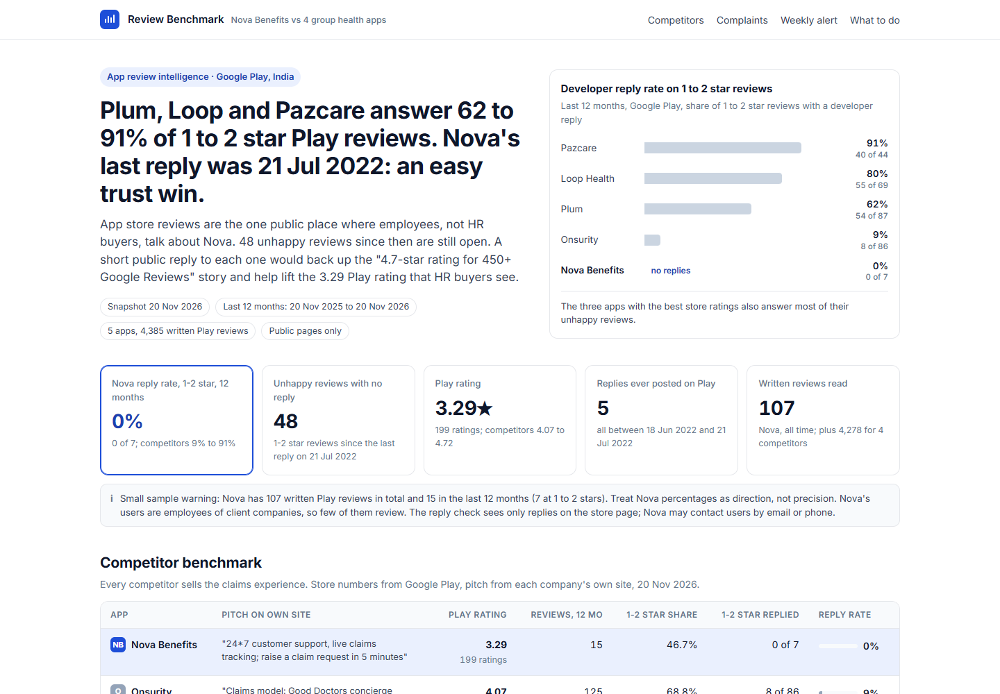

# nova-proof: Nova Benefits app reviews, competitor reply rates, and a weekly review alert



- **Problem:** app store reviews are the one public place where employees, not HR buyers, talk about Nova, and any HR buyer comparing Nova with Plum or Pazcare can read them.
- **Result:** Pazcare answers 91% of 1 to 2 star Play reviews, Loop Health 80% and Plum 62%. Nova's last reply was 21 Jul 2022 (48 unanswered since; 0 of 7 in the last 12 months), so replying is an easy trust win.
- **Demo page:** open `web/index.html` in a browser (no install, no server), or run `python -m http.server -d web` and visit http://localhost:8000. Mobile view: [docs/screenshot_390.png](docs/screenshot_390.png).

Snapshot: 20 Nov 2026, public pages only. The full write-up, with sources, is [REPORT.md](REPORT.md).

## Reply rate on 1 to 2 star Play reviews, last 12 months

| App | 1-2 star, last 12 months | Replied | Rate | Play rating, ratings |
|---|---|---|---|---|
| Pazcare | 44 | 40 | 91% | 4.58, 3,817 |
| Loop Health | 69 | 55 | 80% | 4.62, 8,994 |
| Plum | 87 | 54 | 62% | 4.72, 6,399 |
| Onsurity | 86 | 8 | 9% | 4.07, 7,226 |
| Nova Benefits | 7 | 0 | 0% | 3.29, 199 |

## What Nova's unhappy reviews are about

44 of Nova's 56 one and two star Play reviews have six or more words. Keyword rules tagged them (a review can have several themes): app login, sign out or crash 12; could not reach support 9; claim slow or no update 8; claim rejected 8; cashless or hospital 6; documents asked again 4; paid check-ups or refunds 4; none of the above 7.

## What I'd do

1. Answer every 1 to 2 star review within 2 working days, starting with the 18 Oct 2026 one. Measure: reply rate (now 0%) and the rating trend.
2. One complete document list per claim. Track "times documents requested per claim" and aim for one.
3. Fix the sign-out and lost-chat bugs first (12 of 44).
4. Run the weekly alert so reviews reach ops without anyone opening the store console.

## Tool: review_alert.py

A weekly digest for any Play app. It pulls new reviews, tags the 1 to 2 star ones by theme, and lists every one without a reply. Exit code 1 means "something needs a reply", so it can run on a scheduler.

```
pip install google-play-scraper pytest
python review_alert.py --app com.novabenefits --days 7
python review_alert.py --csv data/nova_play.csv --days 60 --today 2026-11-20   # sample on the snapshot
python -m pytest -q tests                                                     # 11 tests, no network
python fetch.py com.novabenefits 5000 data/nova_play.csv                      # refetch; same for the 4 competitor ids in analyze.py
python analyze.py                                                             # -> data/summary.json
python web/export.py                                                          # refresh the demo page data
```

## Limits

- Nova has 107 written Play reviews in total and 15 in the last 12 months. Treat Nova percentages as direction, not precision.
- Theme tags are keyword rules, hand-checked on Nova only.
- The reply check sees only replies shown on the store page. Nova may contact users by email or phone.
